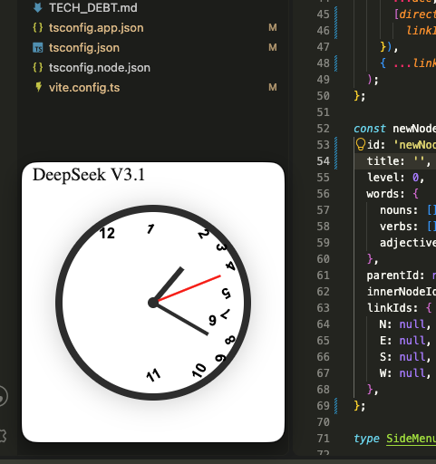
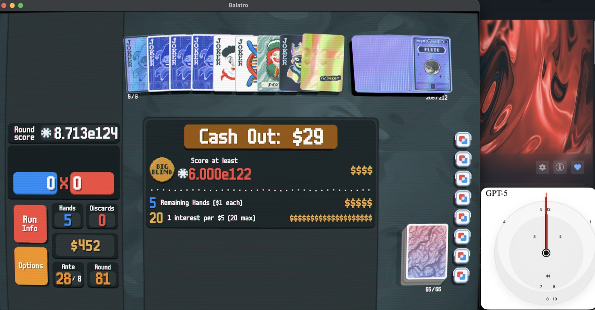
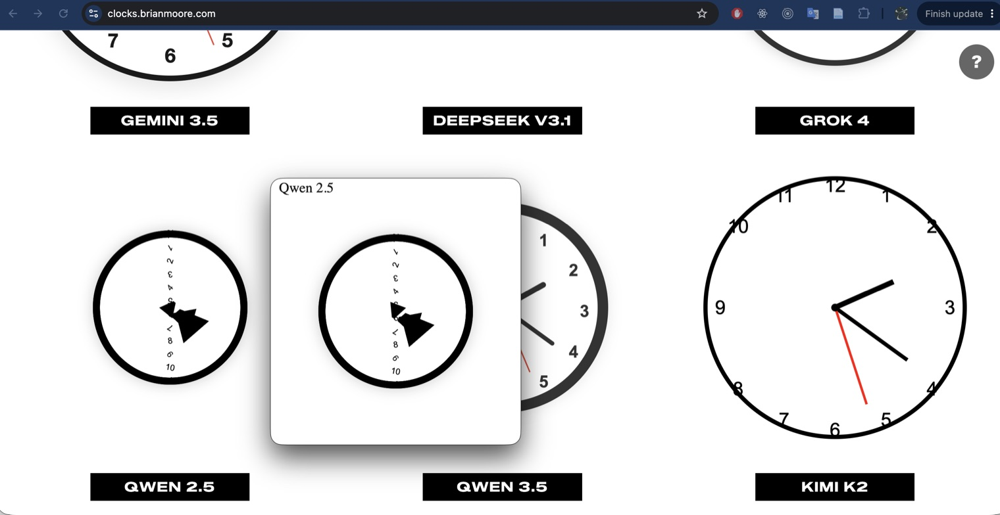

# Flock of Clock

A tiny desktop overlay that sits in the corner of your screen and shows a
different AI-generated analog clock every minute.

The clocks come from [AI World Clocks](https://clocks.brianmoore.com/), where
fifteen different language models are each asked to write an analog clock in
HTML and CSS. Some of them are lovely. Some of them have a second hand that
completes a full revolution every two seconds. That's the appeal.

It is, functionally, a fidget spinner for your eyes.

## What it looks like



Parked in the corner while you work. This is DeepSeek V3.1, which has opinions
about which way up a number goes.



GPT-5 keeping time over a run of Balatro — always-on-top means it could have
been put over, but I didn't want it blocking anything.



And since the clocks come from a live page, you can catch one sitting next to its
own twin: the app's Qwen 2.5 on top, the source site's underneath it. Nothing is
reimplemented here — it is the model's own HTML either way.

## Running it

```sh
npm install
npm start
```

The window is frameless and always-on-top, you can drag it anywhere and resize
it down to something unobtrusive on a laptop screen.

## How it works

The main process fetches from the clocks API once a minute, passing your local
time so the hands are right for your timezone rather than the server's. It picks
one of the fifteen models at random and hands that single clock to the renderer,
which drops the document into an `<iframe srcdoc>` — the iframe is there for
isolation, so fifteen authors' worth of conflicting CSS can't leak into the app.

Nothing is scaled or normalised — each clock sizes itself, and the variation
in how big each model thinks a clock should be is part of the fun.

## Offline

Clocks are baked for the minute they were generated: the hands are drawn at
fixed angles, and only the second hand moves. That would make a stale clock
simply wrong, so the cache is keyed by the time on the dial rather than by when
it was fetched.

Every clock that gets displayed is saved to `cache.json` in the app's user-data
directory (`~/Library/Application Support/Flock of Clock/` on macOS), filed under
its position on a 12-hour dial. A clock generated at 2:23 is correct again at
2:23 tomorrow, and AM and PM are indistinguishable on an analog face, so 720
entries — about 2.3 MB — covers every possible minute. It fills in on its own as
the app runs.

When a fetch fails, the app uses the cached clock for the current minute if it
has one — right time, wrong day. Failing that, it picks at random from
`favourites.json` plus `fallback.html` — a deliberately silly hand-made clock
called Bob 1.0, added to the pool so it is never empty. Wrong time, but a
nice-looking clock beats the same one every time.

## Collecting favourites

`Cmd+E` saves whatever clock is currently on screen into `favourites.json`. This
is a development tool for curating the bundled fallback pool, not a user feature
— it writes into the source directory, so it only works when running unpackaged.

Note that it registers a **global** shortcut, so while the app is running it
takes `Cmd+E` from every other application on the machine.

## Building

```sh
npm run make
```

Built and tested on macOS. The transparency and always-on-top behaviour is
platform-specific and hasn't been checked anywhere else.

## Blocked scripts

Some models build part of the UI from an inline `<script>`. That never runs here: 
`render.js` sets `iframe.sandbox = ''`, and `index.html`'s `script-src 'self'` is inherited by the `srcdoc` document.

This is deliberate — the app renders arbitrary HTML off the network once a
minute. The cost is that about one clock in ten arrives looking different from its live-site twin.

## Credit

All the clocks are generated by [AI World Clocks](https://clocks.brianmoore.com/)
by [Brian Moore](https://brianmoore.com), based on an idea by
[Matthew Rayfield](https://matthew.rayfield.world/). The clocks bundled in
`favourites.json` are included with his permission. This overlay is just a
window onto his project — go look at the original, it's better.

## Status

A learning project. Personal use, no license.
